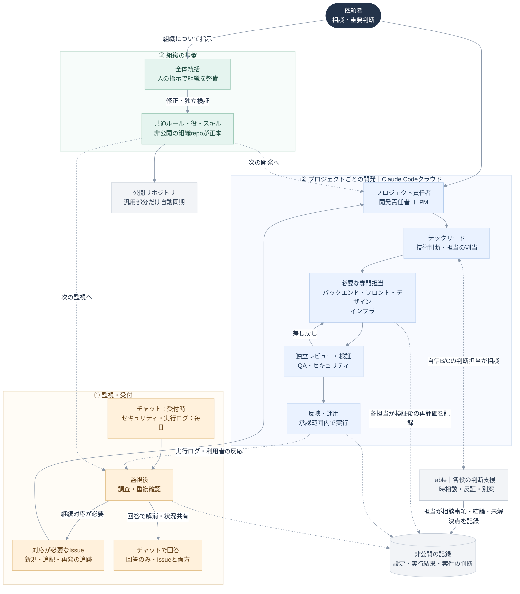

# 組織と開発・監視の全体図

1プロジェクト＝機能追加・改修1件。専門担当は必要時だけ起動し、レビューは実装者と分ける。
定期実行は未登録、Fableの自動連携は未実装。監視・案件の整理は `/org-monitor-setup` から設定する。組織への展開は人の指示時だけ行う。
キー情報の保存先は作成・配置前に `.gitignore` へ登録し、Gitに入れない（AGENTS.mdの絶対ルール）。

フィードバックの流れは [別図](フィードバック図.md) を参照。
